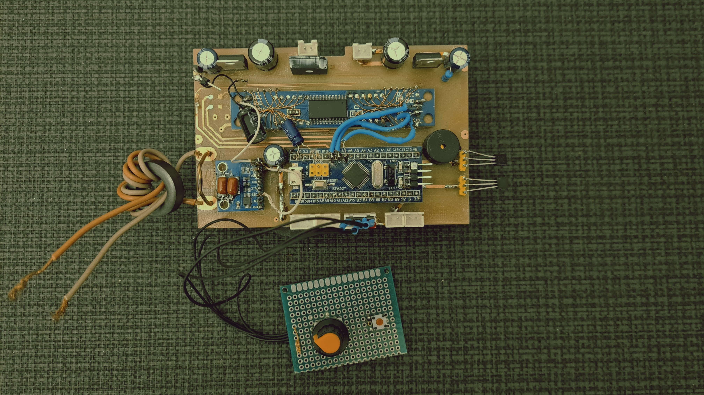
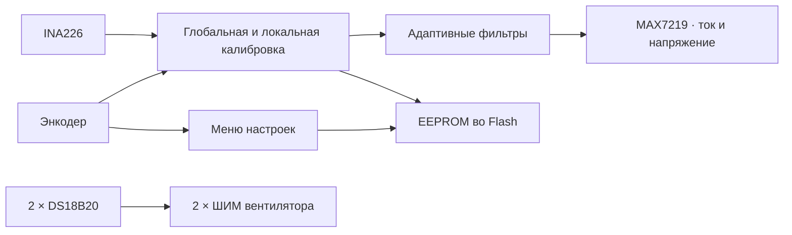

<p align="center">
  
</p>

<h1 align="center">VAW Meter · PS-305D</h1>

<p align="center">
  <strong>Новая жизнь трансформаторного лабораторного блока питания.</strong><br>
  Измерение напряжения и тока, многоточечная калибровка и два канала охлаждения — на STM32.
</p>

<p align="center">
  <a href="#features">Возможности</a> ·
  <a href="#gallery">Фотографии</a> ·
  <a href="#hardware">Схемы</a> ·
  <a href="#build">Сборка</a> ·
  <a href="docs/calibration.md">Калибровка</a> ·
  <a href="docs/settings.md">Настройки</a>
</p>

---

Проект модуля для модернизации лабораторных блоков питания трансформаторного типа, в том числе семейства **PS-305D**. Вместо штатной простой индикации используются восемь семисегментных разрядов под управлением MAX7219, измерительный модуль INA226 и энкодер для настройки.

Микроконтроллер также управляет двумя вентиляторами по температуре радиатора и трансформатора и формирует сигналы переключения обмоток. Проект можно адаптировать к другому блоку питания, сверив силовую часть, распиновку и параметры измерительного тракта.

<a id="gallery"></a>
## Прототип в работе

<table>
  <tr>
    <td width="50%" align="center"><a href="platformio/20261124_132426.jpg"></a></td>
    <td width="50%" align="center"><a href="platformio/20261124_132511.jpg"></a></td>
  </tr>
  <tr>
    <td align="center">Индикация и энкодер</td>
    <td align="center">Монтаж электронного модуля</td>
  </tr>
</table>

Фотографии и схемы взяты из файлов этого проекта. Нажмите на изображение, чтобы открыть оригинал.

<a id="features"></a>
## Что умеет модуль

| Измерения | Калибровка | Управление |
|---|---|---|
| INA226: напряжение и реальный ток | Отдельный глобальный коэффициент каждого канала | Энкодер и меню из 19 параметров |
| Адаптивные медианные фильтры | По 100 локальных коэффициентов на канал | Два датчика DS18B20 и два вентилятора |
| Автоматическое положение десятичной точки | Интерполяция между коэффициентами | ШИМ охлаждения 25 кГц |
| Подавление остаточных показаний до 2 мА | Сохранение калибровки во Flash | Релейные выходы и звуковые сигналы |

### Основные параметры

| Параметр | Текущая реализация |
|---|---|
| Микроконтроллер | STM32F103C8T6, плата типа Blue Pill |
| Среда разработки | PlatformIO, Arduino framework, C++ |
| Измерительный модуль | INA226, адрес I²C `0x40` |
| Шунт в настройке драйвера | `0,01 Ом`, расчётный максимальный ток `10 А` |
| Сетка калибровки напряжения | 100 диапазонов по 0,36 В, область 0–36 В |
| Сетка калибровки тока | 100 диапазонов по 0,1 А, область 0–10 А |
| Индикация | MAX7219, четыре разряда тока и четыре разряда напряжения |
| Разрешение индикации | До 0,001 В и 0,001 А; от 10 — два знака после точки |
| Температурные датчики | 2 × DS18B20 |
| Выходы вентилятора | 2 канала ШИМ, 25 кГц, диапазон 0–255 |
| Сохранение параметров | Эмуляция EEPROM во Flash STM32, записи с контрольными суммами |
| Прошивка и отладка | J-Link в текущем `platformio.ini` |

Разрешение индикации не равно гарантированной точности измерений. Результат зависит от шунта, монтажа, помех и калибровки по эталонному прибору. Сетка калибровки также не определяет допустимые электрические пределы всех компонентов.

<a id="hardware"></a>
## Схемы и подключение

В проекте есть три схемы прототипа:

| Подключение STM32 | Индикаторы MAX7219 |
|---|---|
| [](platformio/5262779249662302666.jpg) | [](platformio/5262779249662302663.jpg) |

<details>
<summary><strong>Показать схему питания</strong></summary>

[](platformio/5393225360721251683.jpg)

</details>

Полная распиновка, назначение разъёмов по коду и пояснения к схемам — в [описании аппаратной части](docs/hardware.md).

<a id="build"></a>
## Быстрый старт

### 1. Откройте проект

Установите PlatformIO и откройте каталог **`platformio`** — именно в нём находится `platformio.ini`.

```bash
git clone https://github.com/Spectrum-Man85/VAW_metr_stm32_max7219_-ps-305d-.git
cd VAW_metr_stm32_max7219_-ps-305d-
pio run --project-dir platformio
```

В конфигурации выбраны плата `genericSTM32F103C8`, платформа `ststm32` и Arduino framework. OneWire подключается через `lib_deps`; остальные используемые модули находятся в проекте или входят в Arduino framework STM32.

### 2. Подключите программатор

Текущая конфигурация рассчитана на **J-Link**:

```bash
pio run --project-dir platformio --target upload
```

Для ST-Link необходимо изменить `upload_protocol` и `debug_tool` на `stlink` в [platformio.ini](platformio/platformio.ini). Само наличие комментария о ST-Link в файле не переключает используемый программатор.

### 3. Настройте измерительный тракт

Проверьте соответствие шунта настройке `INA226 ina(0.01f, 10.0f)` в [main.cpp](platformio/src/main.cpp), подключение датчиков и выходов. Затем выполните [глобальную и локальную калибровку](docs/calibration.md).

На Windows для сборки рекомендуется короткий путь без кириллицы, например `C:/tmp/vaw-meter`.

## Управление одним энкодером

В обычном режиме **ток находится слева, напряжение — справа**.

| Действие | Результат |
|---|---|
| Одно короткое нажатие | Калибровка напряжения |
| Следующее короткое нажатие | Калибровка тока |
| Ещё одно короткое нажатие | Возврат к измерениям; при первичной настройке — подтверждение глобального коэффициента тока |
| Двойное короткое нажатие из режима измерений | Меню параметров |
| Удержание более 0,8 с с отпусканием | Вход в меню параметров; из меню — выход с сохранением |
| Вращение в меню | Выбор параметра |
| Короткое нажатие в меню | Включение или завершение редактирования |

При редактировании значение справа мигает. Подробная [таблица всех 19 параметров](docs/settings.md) вынесена отдельно.

> **Глобальная калибровка:** включите прибор с зажатой кнопкой — слева появится `GU`, справа напряжение. Стартовое удержание и его отпускание не считаются нажатием. После отпускания кнопки настройте напряжение: новое короткое нажатие сохранит его коэффициент и сразу переведёт в `GA` (ток слева, метка справа). Следующее нажатие сохранит коэффициент тока и вернёт измерения. Перезапуска между этапами нет. [Подробная инструкция](docs/calibration.md).

## Как устроена прошивка



| Файл | Назначение |
|---|---|
| [main.cpp](platformio/src/main.cpp) | Основной цикл, измерения, реле и индикация |
| [Calibration.h](platformio/include/Calibration.h) | Глобальные и локальные коэффициенты, интерполяция, хранение калибровки |
| [MeasurementFilters.h](platformio/include/MeasurementFilters.h) | Адаптивная медианная фильтрация |
| [EncoderInput.h](platformio/include/EncoderInput.h) | События энкодера и ускорение регулировки |
| [INA226_mod.h](platformio/include/INA226_mod.h) | Активный драйвер INA226 |
| [memory_view.cpp](platformio/src/memory_view.cpp) | Меню параметров |
| [temp_fan.cpp](platformio/src/temp_fan.cpp) | Температура и управление вентиляторами |
| [eep_new.h](platformio/src/eep_new.h) | Хранение настроек прибора и чтение старого формата |

Старые файлы и таблицы сохранены для совместимости. `filters.cpp` исключён из сборки; рабочая фильтрация находится в `MeasurementFilters.h`. Библиотека `lib/INA226-master` не является активным измерительным драйвером.

## Документация

- [Аппаратная часть и распиновка](docs/hardware.md)
- [Глобальная и локальная калибровка](docs/calibration.md)
- [Меню настроек: 19 параметров](docs/settings.md)
- [Каталог фотографий и схем](docs/media.md)

## Статус и ограничения

Проект находится в экспериментальном состоянии. Перед повторением конструкции требуется сверить аппаратную часть со своим блоком питания.

- Пункт «критическая температура радиатора» хранится в настройках, но в текущем коде **не реализует аварийное отключение**.
- Пины реле и температурные пороги требуют проверки при адаптации к другому БП.
- Новая сетка калибровки не использует старые локальные коэффициенты MAX41: после перехода на неё измерения нужно откалибровать заново.

Для замечаний и результатов повторения используйте [Issues](https://github.com/Spectrum-Man85/VAW_metr_stm32_max7219_-ps-305d-/issues). Укажите модель платы, шунт, программатор и шаги воспроизведения; к вопросу по монтажу приложите фотографию.

## Лицензирование

Лицензия на собственный код проекта пока не указана. Сторонние файлы содержат свои лицензии и уведомления об авторстве; они сохраняются в исходниках. Публичная доступность репозитория сама по себе не заменяет выбранную автором лицензию.
