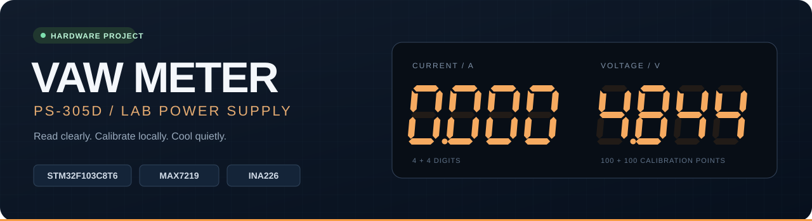
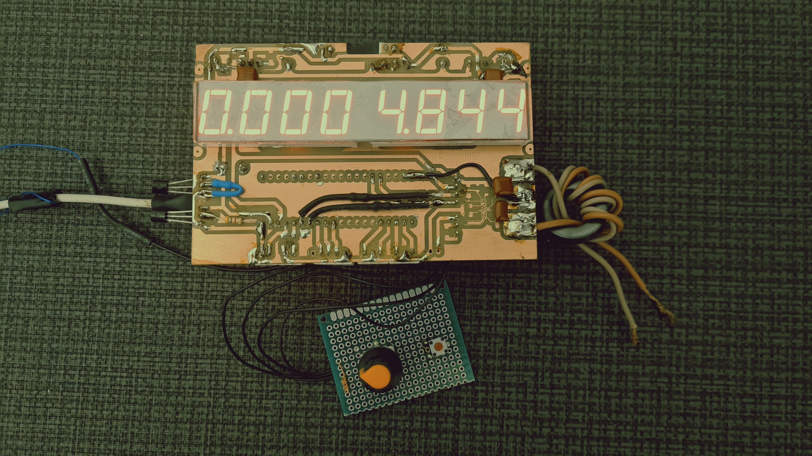
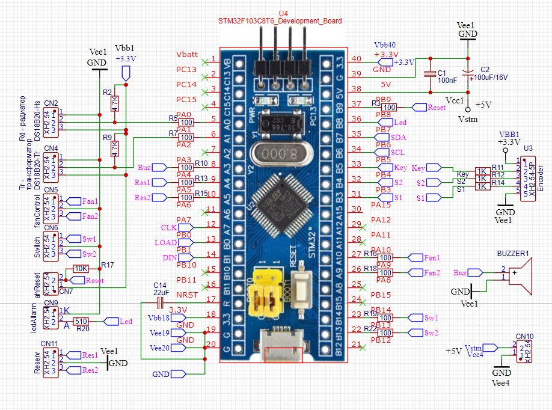
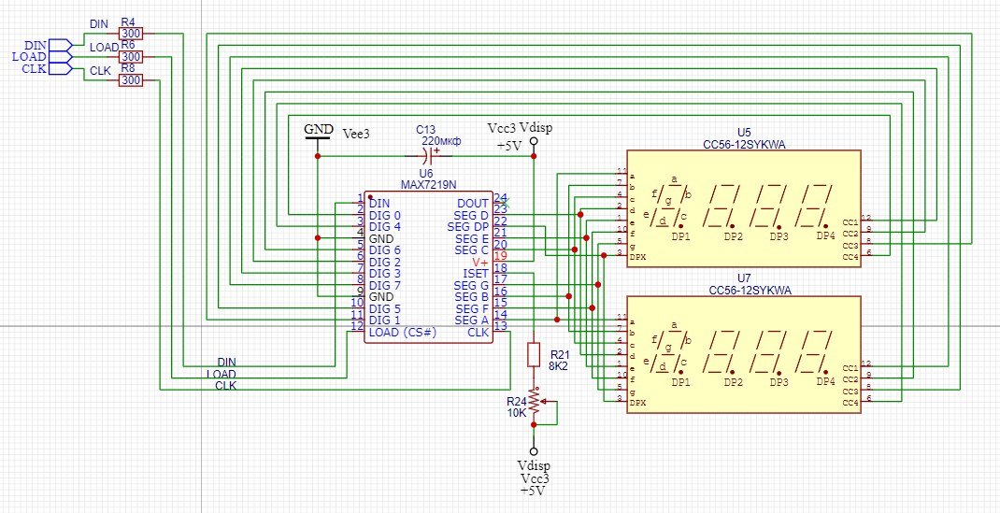
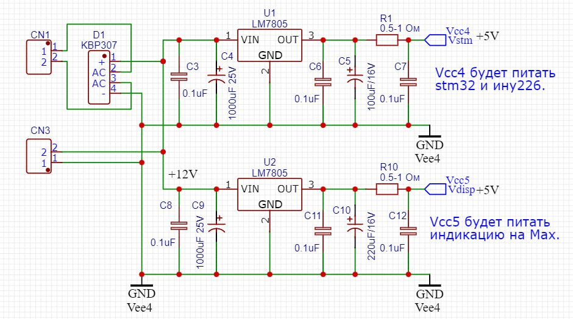
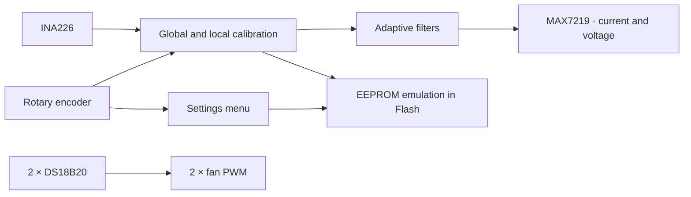

<p align="center">
  
</p>

<h1 align="center">VAW Meter · PS-305D</h1>

<p align="center"><strong>English</strong> · <a href="README.ru.md">Русский</a></p>

<p align="center">
  <strong>A new life for a transformer-based bench power supply.</strong><br>
  Voltage and current measurement, multipoint calibration, and two cooling channels — powered by STM32.
</p>

<p align="center">
  <a href="#features">Features</a> ·
  <a href="#gallery">Photos</a> ·
  <a href="#hardware">Schematics</a> ·
  <a href="#build">Build</a> ·
  <a href="docs/en/calibration.md">Calibration</a> ·
  <a href="docs/en/settings.md">Settings</a>
</p>

---

A measurement and control module for upgrading transformer-based laboratory power supplies, including the **PS-305D** family. It replaces basic factory readouts with eight seven-segment digits driven by a MAX7219, an INA226 measurement module, and a rotary encoder for configuration.

The STM32 also controls two fans based on heatsink and transformer temperatures and provides transformer winding relay outputs. The project can be adapted to other power supplies after checking the power circuitry, pin assignments, and measurement hardware.

<a id="gallery"></a>
## The prototype

<table>
  <tr>
    <td width="50%" align="center"><a href="platformio/20261124_132426.jpg"></a></td>
    <td width="50%" align="center"><a href="platformio/20261124_132511.jpg"></a></td>
  </tr>
  <tr>
    <td align="center">Display and rotary encoder</td>
    <td align="center">Electronic module assembly</td>
  </tr>
</table>

These photographs and schematics are included in the project. Click an image to open the original.

<a id="features"></a>
## Features

| Measurement | Calibration | Control |
|---|---|---|
| INA226 voltage and actual current readings | A separate global coefficient for each channel | Rotary encoder and a 19-item settings menu |
| Adaptive median filters | 100 local coefficients per channel | Two DS18B20 sensors and two fans |
| Automatic decimal point placement | Interpolation between coefficients | 25 kHz fan PWM |
| Residual current readings up to 2 mA suppressed | Calibration stored in Flash | Relay outputs and audible feedback |

### Main specifications

| Parameter | Current implementation |
|---|---|
| Microcontroller | STM32F103C8T6, Blue Pill-style board |
| Development environment | PlatformIO, Arduino framework, C++ |
| Measurement module | INA226, I²C address `0x40` |
| Driver shunt configuration | `0.01 Ω`, configured maximum current `10 A` |
| Voltage calibration grid | 100 ranges of 0.36 V, covering 0–36 V |
| Current calibration grid | 100 ranges of 0.1 A, covering 0–10 A |
| Display | MAX7219, four current digits and four voltage digits |
| Display resolution | Up to 0.001 V and 0.001 A; two decimal places at 10 and above |
| Temperature sensors | 2 × DS18B20 |
| Fan outputs | Two PWM channels, 25 kHz, values 0–255 |
| Parameter storage | EEPROM emulation in STM32 Flash, with record checksums |
| Upload and debugging | J-Link in the current `platformio.ini` |

Display resolution is not a guarantee of measurement accuracy. Results depend on the shunt, assembly, electrical noise, and calibration against a reference instrument. The calibration grid does not define the electrical ratings of the hardware components.

<a id="hardware"></a>
## Schematics and connections

The project includes three prototype schematics:

| STM32 connections | MAX7219 display |
|---|---|
| [](platformio/5262779249662302666.jpg) | [](platformio/5262779249662302663.jpg) |

<details>
<summary><strong>Show the power supply schematic</strong></summary>

[](platformio/5393225360721251683.jpg)

</details>

See the [hardware guide](docs/en/hardware.md) for the complete firmware pinout and notes on the original schematics. The images retain their original labels; the pinout and explanations are available in English.

<a id="build"></a>
## Quick start

### 1. Open the project

Install PlatformIO and open the **`platformio`** directory, which contains `platformio.ini`.

```bash
git clone https://github.com/Spectrum-Man85/VAW_metr_stm32_max7219_-ps-305d-.git
cd VAW_metr_stm32_max7219_-ps-305d-
pio run --project-dir platformio
```

The configuration selects the `genericSTM32F103C8` board, the `ststm32` platform, and the Arduino framework. OneWire is declared in `lib_deps`; the other active modules are included in the project or provided by the STM32 Arduino framework.

### 2. Connect the programmer

The current configuration uses **J-Link**:

```bash
pio run --project-dir platformio --target upload
```

For ST-Link, change both `upload_protocol` and `debug_tool` to `stlink` in [platformio.ini](platformio/platformio.ini). The existing ST-Link comment alone does not change the selected programmer.

### 3. Configure the measurement hardware

Check that your shunt matches `INA226 ina(0.01f, 10.0f)` in [main.cpp](platformio/src/main.cpp), and verify the sensor and output wiring. Then perform [global and local calibration](docs/en/calibration.md).

On Windows, use a short ASCII-only build path, such as `C:/tmp/vaw-meter`.

## One encoder, all controls

In normal measurement mode, **current is on the left and voltage is on the right**.

| Action | Result |
|---|---|
| One short press | Voltage calibration |
| The next short press | Current calibration |
| Another short press | Return to measurements; during initial current calibration, confirm the global current coefficient |
| Double short press from measurement mode | Open the settings menu |
| Hold for more than 0.8 s, then release | Open the settings menu; inside the menu, exit and save |
| Turn the encoder in the menu | Select a setting |
| Short press in the menu | Start or finish editing |

The right-hand value blinks while being edited. See the complete [19-item settings table](docs/en/settings.md).

> **Global calibration:** power on with the encoder button held. `GU` appears on the left and voltage on the right. The startup hold and release do not count as a click. Release the button, adjust the voltage, then make a new short press to save its coefficient and move directly to `GA` (current on the left, label on the right). The next press saves the current coefficient and returns to measurements. There is no restart between stages. [Step-by-step guide](docs/en/calibration.md).

## Firmware structure



| File | Purpose |
|---|---|
| [main.cpp](platformio/src/main.cpp) | Main loop, measurements, relays, and display |
| [Calibration.h](platformio/include/Calibration.h) | Global and local coefficients, interpolation, and calibration storage |
| [MeasurementFilters.h](platformio/include/MeasurementFilters.h) | Adaptive median filtering |
| [EncoderInput.h](platformio/include/EncoderInput.h) | Encoder events and adjustment acceleration |
| [INA226_mod.h](platformio/include/INA226_mod.h) | Active INA226 driver |
| [memory_view.cpp](platformio/src/memory_view.cpp) | Settings menu |
| [temp_fan.cpp](platformio/src/temp_fan.cpp) | Temperature acquisition and fan control |
| [eep_new.h](platformio/src/eep_new.h) | Device settings storage and legacy format loading |

Legacy files and tables are retained for compatibility. `filters.cpp` is excluded from the build; active filtering is implemented in `MeasurementFilters.h`. The `lib/INA226-master` library is not the active measurement driver.

## Documentation

| Guide | English | Русский |
|---|---|---|
| Hardware and pinout | [Read](docs/en/hardware.md) | [Читать](docs/hardware.md) |
| Global and local calibration | [Read](docs/en/calibration.md) | [Читать](docs/calibration.md) |
| All 19 settings | [Read](docs/en/settings.md) | [Читать](docs/settings.md) |
| Photos and schematics | [Read](docs/en/media.md) | [Читать](docs/media.md) |

## Status and limitations

This is an experimental hardware and firmware project. Check the hardware against your particular power supply before reproducing the design.

- The heatsink critical-temperature setting is stored, but it **does not currently implement an emergency shutdown**.
- Verify relay pin assignments and temperature thresholds when adapting the module to a different power supply.
- The new calibration grid does not reuse the old MAX41 local coefficients. Recalibrate the measurement channels after migrating to it.

Use [Issues](https://github.com/Spectrum-Man85/VAW_metr_stm32_max7219_-ps-305d-/issues) to report problems or share your build. Include your board model, shunt value, programmer, and reproduction steps. For wiring questions, include a photograph.

## Licensing

A license for the project's own code has not yet been specified. Third-party files retain their respective license and copyright notices in the source tree. Public repository visibility does not replace a license chosen by the author.
