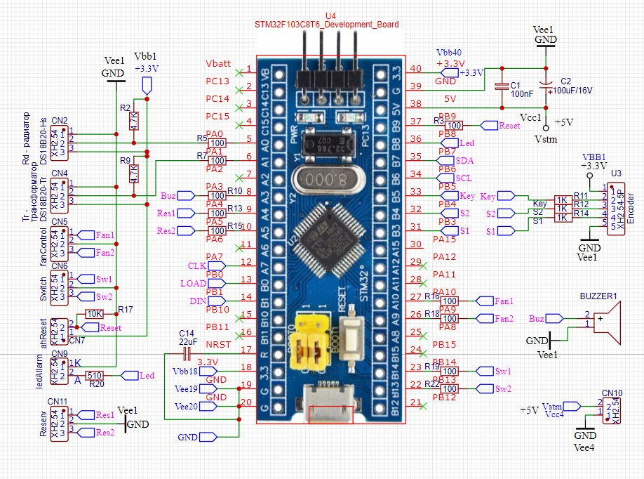
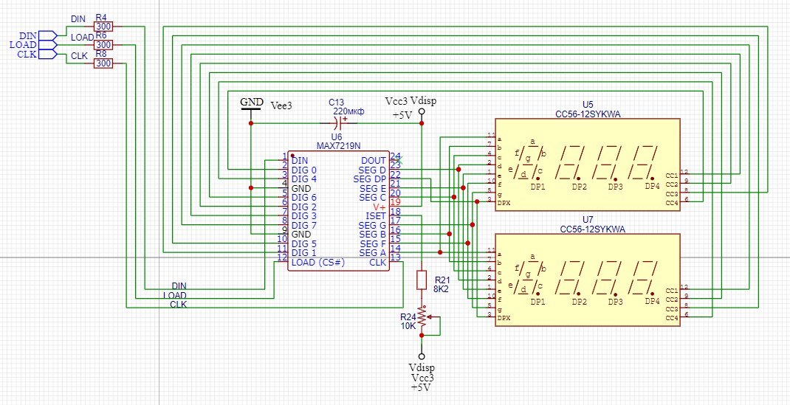
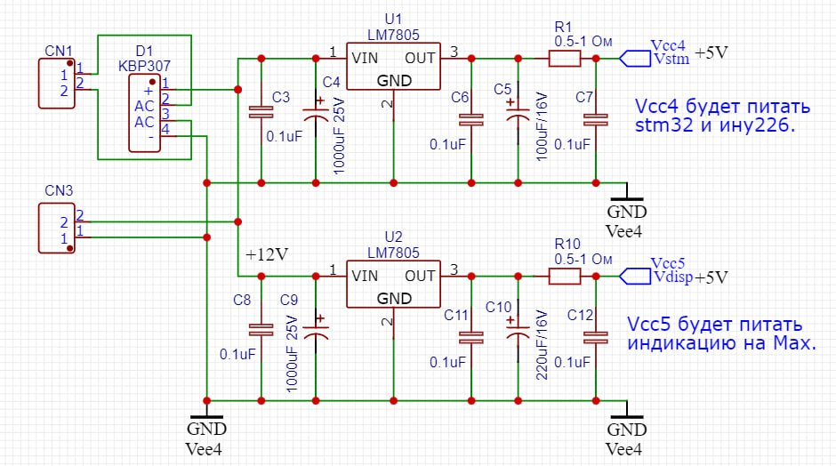

# Hardware

**English** · [Русский](../hardware.md)

[← Project overview](../../README.md) · [Calibration](calibration.md) · [Settings](settings.md)

## Module components

| Component | Implementation |
|---|---|
| Controller | STM32F103C8T6, Blue Pill board |
| Measurement | INA226, I²C `0x40` |
| Display | MAX7219 and two four-digit seven-segment displays |
| User input | Rotary encoder with push button |
| Temperature sensing | Two DS18B20 sensors on separate data lines |
| Cooling | Two fan PWM control channels |
| Additional outputs | Two relay control signals and a buzzer |

## Current firmware pinout

| Function | STM32 pin | Notes |
|---|---|---|
| MAX7219 DIN | PB1 | Display data |
| MAX7219 CLK | PA7 | Clock |
| MAX7219 LOAD / CS | PB0 | Device select |
| INA226 SDA | PB7 | I²C data |
| INA226 SCL | PB6 | I²C clock |
| Encoder A / S1 | PB3 | Input with pull-up |
| Encoder B / S2 | PB4 | Input with pull-up |
| Encoder button | PB5 | Active low, input with pull-up |
| Heatsink sensor | PA0 | DS18B20, first channel |
| Transformer sensor | PA1 | DS18B20, second channel |
| Heatsink fan | PA10 | TIM1 channel 3; 25 kHz PWM |
| Transformer fan | PA9 | TIM1 channel 2; 25 kHz PWM |
| Relay Sw1 | PB14 | Requires an external power driver stage |
| Relay Sw2 | PB13 | Requires an external power driver stage |
| Buzzer | PA3 | Type selected in the settings menu |
| Additional Res input | PB9 | Configured as an input with pull-up; a separate reset function on this input is not implemented in the current code |
| Onboard LED | PC13 | Activity indicator |

Pin assignments are taken from [BoardPins.h](../../platformio/include/BoardPins.h), [main.cpp](../../platformio/src/main.cpp), and [temp_fan.cpp](../../platformio/src/temp_fan.cpp).

## Controller schematic

[](../../platformio/5262779249662302666.jpg)

This is the original prototype schematic. Its labels are preserved in their original language; the table above provides the English pinout. Some pins shown in the drawing are reserved and are not used by the current firmware. Use the table for active functions. PB3/PB4 are assigned to the encoder; use SWD rather than full JTAG for debugging.

## Displays and MAX7219

[](../../platformio/5262779249662302663.jpg)

The eight digits form two fields: **current on the left and voltage on the right**. During local calibration, the other measurement field shows the range number. Global calibration uses the `GU` and `GA` labels described in the [calibration guide](calibration.md).

The firmware uses one MAX7219 with software-driven communication over three pins. If using a ready-made module, check its segment and digit wiring: physical compatibility does not guarantee the same digit order.

## Power supply

[](../../platformio/5393225360721251683.jpg)

The original drawing provides separate +5 V rails for the controller with INA226 and for the display. Component values and regulator wiring are shown in the image. This is the prototype module's supply schematic, not a complete schematic of the PS-305D power stage.

Wire the measurement connections to suit the shunt and common-ground arrangement. Menu item 19 is used only for software voltage-drop compensation; it **does not change** the shunt value passed to the INA226 driver constructor.

## Measurement configuration

Current configuration in `main.cpp`:

```cpp
INA226 ina(0.01f, 10.0f);
```

This configures a 0.01 Ω shunt and a maximum current of 10 A. For a different shunt, update the driver configuration before calibration. The shunt's power rating and permissible load conditions depend on the physical hardware.

## Cooling

Each channel has a start temperature, a temperature for maximum PWM, and minimum and maximum PWM values:

- Below the start temperature, the fan is off.
- Between the temperature thresholds, the target PWM increases linearly.
- Above the upper threshold, the maximum PWM value is used.

Both temperature readings and the control signal are smoothed. The firmware PWM frequency is **25 kHz**. The older text description states 20 kHz, which does not match the current constant.

The heatsink critical-temperature parameter is not connected to an emergency shutdown action. It must not be treated as an active protection function.
