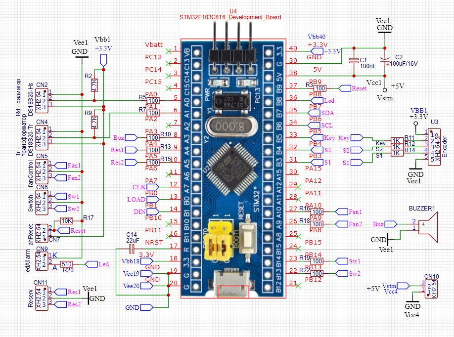
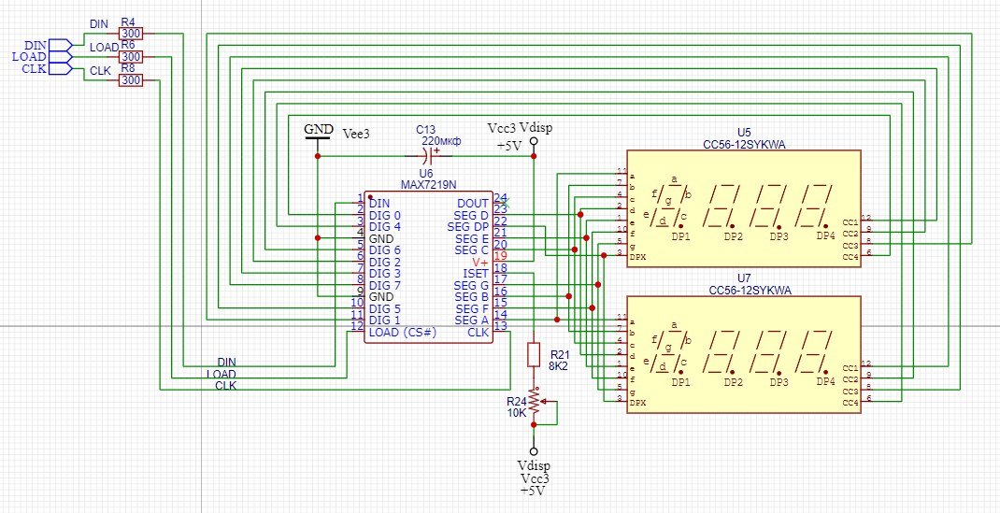
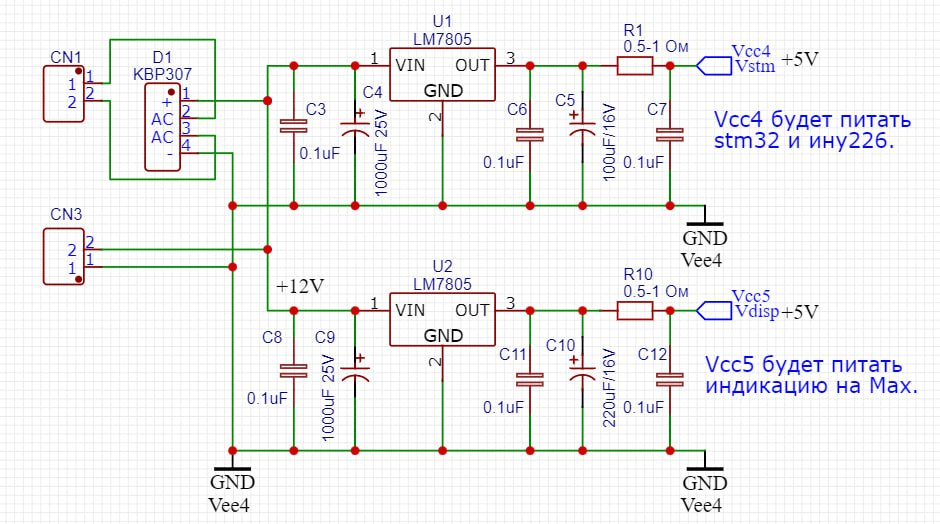

# Аппаратная часть

[← Главная страница](../README.md) · [Калибровка](calibration.md) · [Меню](settings.md)

## Состав модуля

| Узел | Реализация |
|---|---|
| Контроллер | STM32F103C8T6, плата Blue Pill |
| Измерение | INA226, I²C `0x40` |
| Индикация | MAX7219 и два четырёхразрядных семисегментных индикатора |
| Управление | Энкодер с кнопкой |
| Температура | Два датчика DS18B20 на отдельных линиях |
| Охлаждение | Два канала ШИМ управления вентиляторами |
| Дополнительные выходы | Два сигнала реле и бузер |

## Распиновка текущей прошивки

| Назначение | STM32 | Примечание |
|---|---|---|
| MAX7219 DIN | PB1 | Данные индикатора |
| MAX7219 CLK | PA7 | Тактовый сигнал |
| MAX7219 LOAD / CS | PB0 | Выбор устройства |
| INA226 SDA | PB7 | Шина I²C |
| INA226 SCL | PB6 | Шина I²C |
| Энкодер A / S1 | PB3 | Вход с подтяжкой |
| Энкодер B / S2 | PB4 | Вход с подтяжкой |
| Кнопка энкодера | PB5 | Активный низкий уровень, подтяжка к питанию |
| Датчик радиатора | PA0 | DS18B20, первый канал |
| Датчик трансформатора | PA1 | DS18B20, второй канал |
| Вентилятор радиатора | PA10 | TIM1, канал 3; ШИМ 25 кГц |
| Вентилятор трансформатора | PA9 | TIM1, канал 2; ШИМ 25 кГц |
| Реле Sw1 | PB14 | Управление через внешний силовой каскад |
| Реле Sw2 | PB13 | Управление через внешний силовой каскад |
| Бузер | PA3 | Тип выбирается в меню |
| Дополнительный вход Res | PB9 | Настроен как вход с подтяжкой; самостоятельная функция сброса на этом входе в текущем коде не реализована |
| Светодиод платы | PC13 | Индикация работы |

Источник распиновки: [BoardPins.h](../platformio/include/BoardPins.h), [main.cpp](../platformio/src/main.cpp), [temp_fan.cpp](../platformio/src/temp_fan.cpp).

## Схема контроллера

[](../platformio/5262779249662302666.jpg)

Это схема прототипа из папки проекта. Некоторые обозначенные на ней выводы зарезервированы и не используются текущей прошивкой. Для активных функций ориентируйтесь на таблицу выше. PB3/PB4 заняты энкодером; для отладки используйте интерфейс SWD, а не полный JTAG.

## Индикаторы и MAX7219

[](../platformio/5262779249662302663.jpg)

Восемь разрядов разделены на два поля: **ток слева, напряжение справа**. В режиме локальной калибровки вместо второго измерения показывается номер диапазона.

В прошивке один MAX7219 и программная передача по трём выводам. Подключение готового модуля должно соответствовать его распиновке сегментов и разрядов; механическая совместимость модуля не гарантирует совпадение порядка цифр.

## Питание

[](../platformio/5393225360721251683.jpg)

На исходной схеме предусмотрены отдельные линии +5 В для контроллера с INA226 и для индикации. Номиналы и включение стабилизаторов приведены на изображении. Это схема питания прототипа, а не полная принципиальная схема силовой части PS-305D.

Подключайте измерительные цепи с учётом расположения шунта и общего провода. Параметр меню №19 используется только для программной компенсации падения напряжения и **не меняет** значение шунта в конструкторе драйвера INA226.

## Измерительный тракт

Текущая настройка в `main.cpp`:

```cpp
INA226 ina(0.01f, 10.0f);
```

Она соответствует шунту 0,01 Ом и расчётному максимальному току 10 А. Для другого шунта настройку драйвера нужно изменить до калибровки. Номинальная мощность шунта и допустимые режимы нагрузки определяются аппаратной конструкцией.

## Охлаждение

Каждый канал имеет начальную и конечную температуру, минимальный и максимальный ШИМ:

- Ниже начальной температуры вентилятор выключен.
- Между порогами целевой ШИМ линейно растёт.
- Выше конечной температуры используется максимальный ШИМ.

Температура и управляющий сигнал сглаживаются. Частота ШИМ в коде — **25 кГц**; в старом текстовом описании указаны 20 кГц, что не соответствует текущей константе.

Параметр критической температуры радиатора пока не подключён к аварийному отключению. Не рассматривайте его как действующую защиту.
